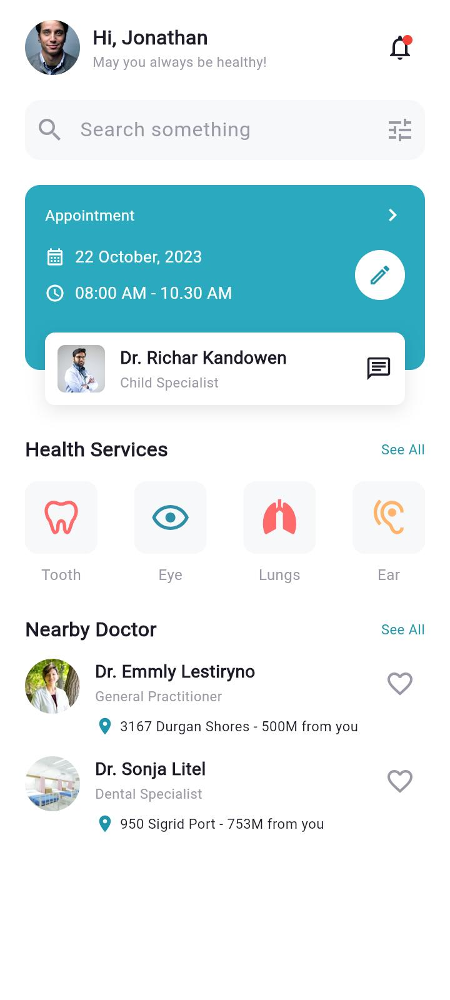
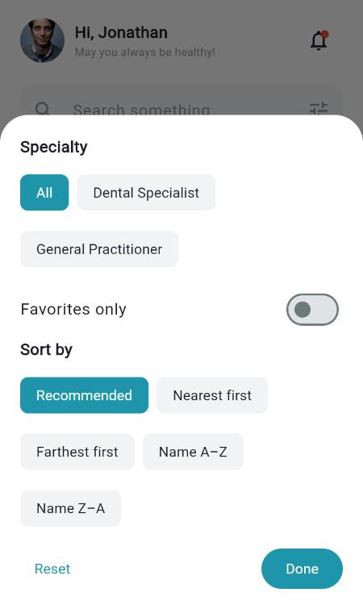
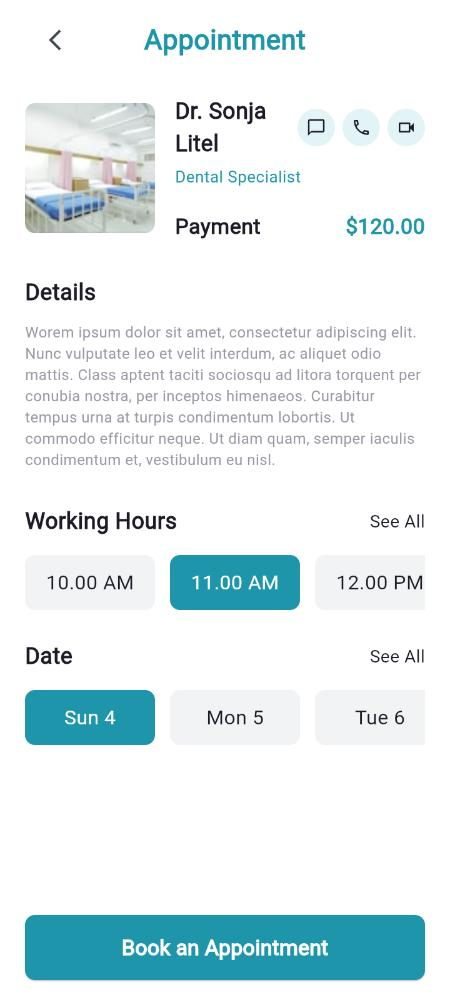

# lab3_appointment

Laborator 3 — aplicația Doctor Appointment (Figma V2) cu **Cubit**
(`flutter_bloc`) și încărcare asincronă a datelor dintr-un fișier JSON.
Designul este cel din laboratorul 2.

| Homescreen | Filtre și sortare | Detalii |
|---|---|---|
|  |  |  |

## Rulare

```bash
flutter pub get
flutter run -d chrome
```

Pentru a arăta stările **Empty** și **Error** (Loading se vede la fiecare
pornire):

```bash
flutter run -d chrome --dart-define=DEMO_STATE=empty
flutter run -d chrome --dart-define=DEMO_STATE=error
```

Verificare:

```bash
flutter analyze
flutter test
```

## Ce face aplicația

| Cerință | Unde se vede |
|---|---|
| Loading / Success / Empty / Error | Homescreen; ecranul de detalii are Loading / Success / Error |
| Listă de elemente | „Nearby Doctor” |
| Căutare | câmpul de search (nume sau specialitate) |
| Filtrare | iconița din dreapta search-ului: specialitate, „Favorites only” |
| Sortare | același panou: distanță sau nume, în ambele sensuri |
| Favorite | inima de lângă fiecare doctor |
| Navigare la detalii | tap pe un doctor sau pe cardul „Appointment” |

## Structura

```
assets/data/lab_v2.json        datele (fișierul de la profesor, varianta 2)
assets/data/lab_v2_empty.json  aceleași date fără doctori, pentru starea Empty
lib/
  main.dart                    alege sursa de date și pornește aplicația
  app.dart                     MaterialApp, repository și HomeCubit
  data/                        AppointmentRepository (citește JSON-ul)
  models/                      clasele create din JSON
  cubits/                      logica și stările ecranelor
  screens/                     Homescreen și detaliile
  widgets/                     componente reutilizabile
  theme/                       culorile
```

## Cum ajung datele din JSON pe ecran

1. La pornire, `DoctorApp` creează `HomeCubit` și apelează `load()`.
2. `load()` emite `HomeLoading` — ecranul arată indicatorul.
3. `AssetAppointmentRepository` citește fișierul asincron
   (`await rootBundle.loadString`), îl decodează cu `jsonDecode`, iar
   `HomeFeed.fromJson` transformă `Map`-ul în obiecte Dart.
4. `HomeCubit` emite `HomeSuccess` (sau `HomeEmpty`, sau `HomeError` dacă
   ceva a aruncat o excepție).
5. `BlocBuilder` din `HomeScreen` redesenează ecranul după starea primită.
6. Când utilizatorul caută, filtrează, sortează sau apasă inima, ecranul
   apelează o metodă din Cubit; Cubit-ul emite o stare nouă, iar lista
   `visibleDoctors` se recalculează din datele originale.
7. La tap pe un doctor se deschide ecranul de detalii cu un `DetailsCubit`
   nou, care încarcă secțiunea `appointmentDetails` și reține ora și ziua
   alese.

```
JSON → Repository → Models → Cubit → State → BlocBuilder → Widgets
                               ▲                              │
                               └──── acțiunile utilizatorului ┘
```

## De știut

- Secțiunea `appointmentDetails` din JSON este una singură. Numele,
  specialitatea și poza sunt ale doctorului ales; plata, descrierea, orele și
  zilele sunt aceleași pentru toți. Doctorul din acea secțiune („Dr.Upul”)
  nu apare, iar din el se folosesc doar butoanele de contact permise.
- Favoritele se păstrează doar cât aplicația este deschisă.
- Pozele și iconițele se încarcă de la adresele din JSON; fără internet apar
  inițialele, respectiv o iconiță generică.
- Citirea are o întârziere simulată de 800 ms, ca starea Loading să fie
  vizibilă.
- Textele din date sunt afișate exact cum sunt în fișier („Dr. Sonja Litel”,
  „10.30 AM”).
